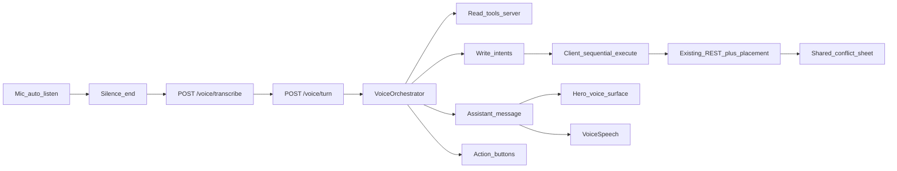

# Specification: Voice Agent (hybrid)

**Status:** shipped (see [roadmap archive](roadmap-archive.md)).  
**Language:** English  
**Last updated:** 22 October 2026  

The product surface is **Companion** (UK: **Помічник**) — a hybrid chat + voice helper: multi-turn dialogue, grounded Q&A, and write intents — without a second scheduler. Placement and conflict stay on [spec-conflict-rules.md](spec-conflict-rules.md) and [spec-incremental-placement.md](spec-incremental-placement.md). The shipped one-shot commander contract remains [spec-voice-commander.md](spec-voice-commander.md); this document supersedes it for the **Companion entry path** (`POST /voice/turn`). HTTP details in [api-reference.md](api-reference.md); Groq keys in [integrations.md](integrations.md).

One utterance may hold several writes plus a question (§6.6). A day plan is a multi-step dialogue: an interview with no question cap, then a proposal seated by the placement engine that the user edits by voice before Apply (§6.4). UI chrome: [features/companion-panel.md](features/companion-panel.md).

---

## 1. Goals

- Let the user **talk with Companion** that reads the calendar/tasks/habits and performs the same mutations the UI can, correctly.
- Keep **one write contract**: orchestrator never mutates the DB; the client executes intents through existing task / habit / placement APIs.
- Support **Q&A**, **multi-turn clarify**, **several writes in one utterance**, a **day-plan dialogue (interview → proposal → voice edits → Apply)**, and a Companion chrome that leaves the calendar usable on desktop.
- Stay safe: destructive actions and day-plan apply require confirm; conflict / Problematic stay on existing client paths in v1.

## 2. Non-goals (v1)

- Wake word / always-on microphone.
- Second scheduler brain or inventing free slots outside placement helpers.
- Phases CRUD or Settings changes by voice.
- Piping conflict-sheet or Problematic outcomes back into the agent session (deferred).
- Server-side TTS on Render. Local Piper is queued in [tts-local.md](tts-local.md); keep the `VoiceSpeech` abstraction for that swap.
- Streaming STT / word-by-word captions.
- Rewriting Whisper / mic capture stack beyond silence detection + UI.
- `undo` action (no product undo API after Generate removal).
- Persisting voice sessions in the database.

---

## 3. Decision log (locked)

| ID | Topic | Decision |
|----|--------|----------|
| L1 / T1 | Client entry | New voice UI **always** calls `POST /voice/turn`. |
| L2 | Clarify budget | Max **2** clarifying questions, then refuse. |
| L3 | Tool surface | Full **read + write-intent** tools mirroring product APIs; limit = product contract, not a short Q&A allowlist. |
| L4 | Write authority | Orchestrator **never** writes DB; client executes intents only. |
| L5 | Confirm | Every write (one task or a batch, Companion or Fast create) shows preview cards and waits for Apply or spoken yes. Day-plan apply does the same. |
| L6 | Day-plan / placement | Same requests as normal engine/UI → same Unscheduled / Problematic / conflict rules. Propose without write until Confirm. |
| L7 | “this” / “current” | LLM resolves from context; if unclear → clarify (counts toward budget). |
| L8 | Close widget | **Discard** pending clarify/confirm (no auto-create on close). |
| L9 | After write | Voice surface **stays open** for follow-up. |
| T2 | Intent shapes | Reuse `executeVoiceCommand` + create payloads; extend for day-plan. |
| T3 | Batch | Multiple write intents per turn allowed; client runs **sequentially**; stop on confirm gate / conflict / error. |
| T5 | Failure | One automatic fallback to `parse-task`; then error + Retry. |
| T6 | Conflict feedback | v1: conflict / Problematic **not** fed back into agent session. |
| T7 | Legacy API | Keep public `POST /voice/parse-task` for compatibility, tests, fallback. |
| S1–S2 | Session store | **In-memory** only; **no idle TTL**; clear on widget close (and server restart). |
| S3 | History | Only the **current open-widget chat**. |
| S4 | Tabs | Separate `sessionId` per browser tab. |
| S5 | Open | **Every widget open → new session.** |
| U1 | Chrome | Product name **Companion** (UK: Помічник). Phone = bottom sheet; desktop = **floating movable/resizable** panel (calendar stays usable; geometry in `localStorage`). |
| U2 | Thread | Scrollable user + Companion bubbles. |
| U3a | End of speech | Silence / VAD ends the utterance; auto-listen when mic is on. Footer **Done** can finish early while listening. |
| U3b | Two skips | `skip_speak` = stop TTS only; `cancel` = dismiss pending turn (+ stop speak). |
| U3c | Actions | Sparse footer by state: idle = Close + mic; listening = Done; speaking = Skip; confirm = **Apply** + Cancel; error = Retry + Close. No redundant “Start speaking”. |
| U4 | Audio visual | Listening + speaking visual. |
| U5 | TTS content | Speak clarify, confirm, success/refuse, **and Q&A answers**; not busy/errors. |
| U6 | Preview UI | Confirm / day-plan show **calendar-style change cards** (name, time, duration, type). Confirm response may include `intents[]` for preview; apply still waits for Apply / spoken yes. |
| U7 | Look | Current design system (`ide` tokens); not a separate brand theme. |
| M1 | Multi-intent scope | Any writes **plus** Q&A in one utterance. The planner splits it into at most **6** segments; each segment goes through the normal router + specialist parse. |
| M2 | Partial clarify | Resolved segments are held while one unclear segment is asked about; at most **2** questions per segment, then it is dropped with a spoken note. If the reply comes back as new write segments, the held resolved writes join them. A command specialist that cannot tell which task is meant asks (no "current task" fallback). |
| M3 | Batch confirm | **One** combined confirm for every write batch. Apply or spoken yes returns `act`. |
| M4 | Execution report | After running intents (no conflict sheet), the client sends `actionId: 'report'` with per-intent statuses; no LLM call. |
| D1 | Plan dialogue | The interview has no question cap. The user ends it by pressing Apply. `build_plan` seats the current draft. Voice edits of the proposal come before Apply. |
| D2 | Plan scope | Unscheduled tasks, new tasks named in the dialogue, and re-seating flexible one-offs already on that day. Fixed tasks, series, external events are never moved. |
| D3 | Plan seating | The placement engine (dry-run) seats the draft in priority order; each seated item blocks the next. Nothing is written until Apply. |
| D4 | Apply mapping | Unscheduled → `window` (+ `clearUnscheduled`); flexible → `shift` of its slot (skipped when unchanged); new → flexible create at the proposed slot with an end-of-day deadline. |
| D5 | Planner model | Planner calls try DeepSeek (`DEEPSEEK_API_KEY`, default `deepseek-flash`), then Qwen (`QWEN_API_KEY`), then Gemini 3.8 Flash (`GEMINI_API_KEY`, thinking `low`), then Groq `openai/gpt-oss-120b`. A missing key skips that step. Parse stays on gpt-oss-20b. `VOICE_LLM_PROVIDER=deepseek` forces every planner and parse call onto DeepSeek and does not fall back. Speech-to-text stays on Groq. |
| F1 | Fast create | The Companion panel has a switch, remembered in `localStorage`. **Companion** is the dialogue above. **Fast create** changes only new tasks: one phrase becomes a create, with at most one question, and only when there is no name or the same span cannot be stored both as the event length and as the placement window. Other missing details use the existing defaults (no day → unscheduled, no length → default duration, a past clock with no day → that clock on schedule tomorrow). Moves, questions, and day plans stay on the Companion rules. The preview card and Apply stay. |

---

## 4. Architecture

**Rules**

- Reads run **on the server** during the turn (grounded answers).
- Writes are **intents in the response**; client applies them via existing APIs.
- Conflict sheet and Problematic inbox behave as today; agent session does not consume their outcomes in v1.
- `parse-task` remains for fallback / tests; it is not the new UI happy path.

---

## 5. Turn outcomes

| Outcome | Meaning | Typical next UI |
|---------|---------|-----------------|
| `answer` | Grounded Q&A; no write | Speak + thread; auto-listen |
| `clarify` | Ask; wait for next utterance | Speak question; listen (clarify count++) |
| `confirm` | Needs explicit confirm before intents | Show summary / plan list + `confirm`/`cancel` |
| `act` | Client should run `intents[]` | Execute; short result; stay open |
| `refuse` | Cannot proceed safely | Speak/show reason; listen or idle |
| *(conflict)* | Not an orchestrator outcome | Client opens shared conflict sheet during execute |

Clarify count is per open session. After **2** clarifications without resolution → `refuse`.

---

## 6. Logic

### 6.1 Dates and times (LLM-first, split prompts)

Parse is **two LLM steps**: (1) router → `intent` + `language`; (2) one specialist prompt per intent. Each specialist states the JSON the resolver reads, a first-match decision list, and what not to invent. Clarifying questions use the transcript language. Router intent `needs_clarification` returns a question only (`task` and `command` null) and does not create a task.

Create specialist focuses on **kind** (`fixed` / `flexible` / `unscheduled` / `recurring`), **name**, and **when**. The planner only splits text; the router chooses the action. Dates named once are one-offs, and a shared clock does not join them; a clock makes a series only when the utterance is already a repeat. A day with no clock, a whole-day event, and a deadline that names a day and no clock run from Wake to Sleep. An event with no time is a question when. A task that is not an event, with no time, is Unscheduled. A place does not decide. A clock with no day that is already past is a question; the model must not write that start or move it to the next day. A clock that is still ahead, with no day, is today. Relative speech (“in 3 hours”) resolves from Local calendar anchors. The schedule day lasts through three hours after sleep and begins three hours before wake. Update changes fields; reschedule only seats the task. The server does **not** re-parse the transcript for days/clocks beyond contract guards (name required; if a past one-off start is still emitted, the normalizer keeps the rest of that civil day until 23:59; a past preferred inside an open window is dropped; recurring clocks stay).

### 6.2 Resolve “this” / “current”

The model uses session chat, now-overlapping app task, current habit block, and last mentioned entities. If still ambiguous → `clarify`. No hard-coded task-only rule.

### 6.3 Confirm policy

| Kind | Confirm |
|------|---------|
| Any write (create, complete, move, delete, …) | Always. One card per write, then Apply |
| day-plan apply | Always |
| Pure `answer` | No |

Spoken yes/no and action button `confirm` / `cancel` are equivalent.

### 6.4 Day-plan dialogue

Shipped behavior is the list below. The dialogue test cycle follows a newer contract: the agent does not end the day-plan dialogue, and the draft grows until the user presses Apply. Oracle: [voice-agent-dialogue-test-plan.md](voice-agent-dialogue-test-plan.md). Where that file and this section differ, the test plan wins for tests and for fixes in that cycle.

The planner LLM decides `plan_start` only when the user explicitly asks to plan, arrange or organize a whole day; listing to-dos for a day stays multi-intent creates (§6.6).

1. **Draft.** The server opens a `planDraft` in the session for that day: up to 10 open Unscheduled tasks (earliest deadline first) plus flexible one-offs that have a single future slot that day (their current start becomes the preferred start, so they stay put unless something conflicts). Constraints and new tasks from the same utterance are applied as plan edits.
2. **Interview (optional).** When the user wants to plan together, the reply is `clarify` with `actions: ['build_plan', 'cancel']` and `plan.stage = 'interview'`. Each answer becomes plan edits. There is no question cap and the server does not propose on its own after a count. `build_plan` seats the current draft.
3. **Proposal.** `VoiceDayPlanner` seats the draft with `PlacementStepService.previewSequence` (dry-run, under the user lock, external calendars fetched once). Items are seated in draft order; a seated item becomes an anchor for the next ones. Plan constraints (preferred start, earliest, deadline, duration) override the stored row. Items that do not fit are listed as `unplaced` with a reason (`no_room` / `deadline_passed` / `conflict`). An empty proposal returns to the interview.
4. **Review.** The reply is `confirm` with `plan.stage = 'review'`, `actions: ['confirm', 'cancel']` and empty `intents`; the Apply intents are held server-side. The mic stays live: every utterance is a plan edit (`add_task`, `include_task`, `remove_item`, `set_preferred_start`, `set_window`, `set_duration`, `set_order`), and the server re-seats and returns the next `revision` with `changedItemIds` (moved, new, or newly unplaced). Questions are answered while the plan stays on screen. Writes about other days run as normal intents beside the plan; the following `report` re-seats the plan against the new calendar.
5. **Apply.** `confirm` (button or spoken yes) returns `act` with the mapped intents (D4) and drops the draft; the client applies them one by one. `cancel` drops the draft (a pending write confirm opened during review cancels back to the plan first). Closing the widget discards it.

### 6.5 Close / open / stay open

- Open widget → **new** `sessionId`.
- Close → discard server session + pending UI state (no auto-create).
- Successful write → sheet **stays open**; same session continues.

### 6.6 Several intents in one utterance

1. The planner returns `steps` with `answer` (spoken reply to any question, grounded in read tools) and `segments` (one self-contained command per write, in the transcript language, at most 6, in spoken order). A shared day or time is copied into each segment; pronouns become task names; a later part that changes an earlier one is merged into one segment.
2. Each segment is parsed by the existing router + specialist (`parse-task` logic) and mapped to intents. A segment that needs a question is held (M2); refusals and parse failures become spoken notes.
3. When every segment is resolved, the reply is `act` (or one `confirm` when any write requires it, M3) with all intents and `segments[]` statuses. The spoken line is the answer first, then each write summary, then notes.
4. If the planner fails, one `parse-task` run on the whole transcript is the fallback (`legacyParse` set).

### 6.7 Execution report

After the client runs a batch without opening the conflict sheet, it sends `{ actionId: 'report', executionReport: { results: [{ summary, status }] } }` where status is `applied` / `skipped` / `conflict` / `error`. The server appends a system line to the chat history (so the next planner turn knows what really happened). If a plan is open in review with nothing pending, the reply re-seats and re-shows it; otherwise it is an empty `answer`. The client shows the batch cards with their statuses ("Done just now").

### 6.8 Fast create

Optional `mode` on `POST /voice/turn` (and on the parse fallback): `assistant` (default) or `fast_create`. The panel switch sends it on every turn and stores it in `localStorage` (`companion-voice-mode`).

In `fast_create` the planner and the create specialist get an extra block that overrides earlier "ask" lines for a **new task** only. A move, a completion, a skip, a delete, a calendar question, and a day plan keep §6.4–§6.6. A new task is still a preview card and Apply. The one allowed question is a missing name, or a span that cannot be stored as both the event length and the placement window.

---

## 7. API surface

### 7.1 `POST /voice/turn`

**Request (conceptual)**

- `transcript` (string, required after STT)
- `sessionId` (string, required for an open widget; client generates on open)
- `locale` / timezone: from user settings on server (same as parse-task)
- Optional: client signal for action tap (`actionId`: `confirm` \| `cancel` \| `build_plan` \| `report`) instead of a new transcript
- Optional `executionReport` with `actionId: 'report'` (§6.7)
- Optional `mode`: `assistant` (default) or `fast_create` (§6.8)

**Response**

- `sessionId`
- `outcome`: `answer` \| `clarify` \| `confirm` \| `act` \| `refuse` \| `legacy_parse`
- `assistantMessage` (string; shown + optionally spoken)
- `intents[]`: zero or more write intents (create / command shapes compatible with today’s client executor). A plan under review sends `[]`; its intents come with the Apply `act`.
- `actions[]`: subset of `confirm` \| `cancel` \| `retry` \| `skip_speak` \| `build_plan`
- `plan`: `{ day, stage: 'interview' | 'review', revision, items[{ itemId, taskId, source, name, start, end, durationMinutes }], unplaced[{ itemId, name, reason }], changedItemIds[] }` or `null`
- `segments[]`: `{ summary, status: 'ready' | 'clarify' | 'refused' | 'dropped' }` for a multi-intent turn
- `clarifyCount`, `legacyParse`

### 7.2 Existing endpoints

| Endpoint | Role |
|----------|------|
| `POST /voice/transcribe` | Unchanged STT |
| `POST /voice/parse-task` | Compatibility, tests, **one** orchestrator failure fallback |

### 7.3 Write intent shapes

Reuse today’s resolved command kinds and create task payload consumed by `executeVoiceCommand` / create flow. Day-plan apply items use the same shapes (D4): `window` with `clearUnscheduled`, `shift` with `slotId`, and create.

---

## 8. Tool registry (starter + extension)

### 8.1 Starter read tools (server)

- `get_now_next`
- `get_day_agenda` (today or named civil day in settings TZ)
- `list_unscheduled`
- `list_problematic`
- `find_free_gaps`
- `match_task` / `match_habit`
- `get_habit_status` (streak / today check-in)
- `get_task` (by id)

### 8.2 Write intents (client-executed)

All Voice Commander mutations: create/update/delete/complete/skip/cancel/move/window, habit CRUD/check-in/uncheck, plus day-plan apply items. No phases/settings.

### 8.3 Adding a voice tool

When a later product feature needs a new capability:

1. Add a tool id to the registry (read vs write-intent).
2. Define JSON schema + English prompt line.
3. Implement server read **or** client intent executor — never a parallel scheduler.
4. Unit test the tool / intent mapping.
5. Append one short subsection under this heading (and tick roadmap if queued).

Do **not** create a separate Cursor skill for tools; use [new-feature-workflow](../.cursor/skills/new-feature-workflow/SKILL.md) and update this spec in wrap-up.

---

## 9. Session

| Rule | Detail |
|------|--------|
| Store | In-memory on API process |
| Key | `sessionId` (+ user id) |
| Scope | One chat = one open widget instance; per tab |
| History | Current chat turns only (compact server-side copy for the LLM) |
| TTL | None while open; delete on close; gone on process restart |
| Open | Always new `sessionId` |

---

## 10. UI (hero voice surface)

### 10.1 Layout

- **Mobile:** near full-screen dismissible surface.
- **Desktop:** large modal/sheet, same structure.
- **Thread:** scrollable user + assistant messages for the session.
- **Mode:** Companion / Fast create, above the thread. Companion is the default. The choice is kept in `localStorage`.
- **Design:** current ide design system; elevated composition (mic, thread, audio visual) — not a new brand theme.

### 10.2 States

| State | UI | Actions |
|-------|-----|---------|
| `listening` | Polished **input** audio visual; mic active | Silence ends utterance; close discards |
| `thinking` | Latest user transcript in thread; working | Close discards |
| `speaking` | Assistant text; polished **speaking** visual; mic gated | `skip_speak` and/or `cancel` as offered |
| `clarify` | Question in thread → return to listening | actions; close discards |
| `confirm` | Summary + preview cards (writes) or the plan cards with changed badges and a "Did not fit" list | `confirm` / `cancel`; plan review keeps mic + composer live for edits; close discards |
| plan interview | Question + "Planning {day}" header | **Make plan** (`build_plan`) / `cancel`; mic live |
| `ready` | Thread; auto-listen when next input expected | close |
| `error` | Error copy | `retry` / close |

Shared **conflict sheet** remains the existing overlay (not redesigned inside voice in v1).

### 10.3 End of speech (no Stop)

- Primary UX: **silence detection** after speech energy (VAD / silence timeout).
- No Stop button as the main control.
- Auto-start listening on open and when the agent expects another user utterance (after speak ends, or immediately if TTS off).

### 10.4 Two skip controls

| Action id | Effect |
|-----------|--------|
| `skip_speak` | Stop TTS + speaking animation only; keep message, plan, pending confirm, intents |
| `cancel` | Dismiss pending confirm / abandon that assistant act; stop speak if playing |

### 10.5 Action buttons

Orchestrator returns `actions[]` from the fixed vocabulary. Client renders labeled buttons (i18n). Tap equals that choice. Default speaking chrome may always expose `skip_speak`; confirm turns expose `confirm` / `cancel`.

### 10.6 Audio visual (replace current equalizer)

Replace `VoiceMicEqualizer` aesthetics. One visual language, two modes:

- **Listening:** driven by real mic level.
- **Speaking:** motion while TTS plays (pulse/waveform); if `speakVoiceReplies` is off, text remains; speaking motion may be omitted.

Concrete CSS/SVG/canvas (or small dependency) is chosen at implementation; must read as intentional on mobile full-screen.

### 10.7 TTS

- Existing `VoiceSpeech` + `speakVoiceReplies`.
- Speak: clarify, confirm summary, success/refuse, **Q&A answers**.
- Do not speak: busy labels, mic permission errors, raw exceptions.
- Stop speak on `skip_speak`, `cancel`, new listen start, or close.

---

## 11. i18n

- UI chrome + TTS language follow settings `language` (`en` \| `uk`).
- Spoken input stays multilingual via Whisper + prompts (as today).
- New strings: full-screen voice labels, skip speak, dismiss, listening without Stop, day-plan proposal chrome, action labels, session/error copy.

---

## 12. Tests

| Layer | Cover when implementing |
|-------|-------------------------|
| Unit | Planner decision parser; batch assembler + partial clarify; plan-draft reducer + apply mapping; `VoiceDayPlanner` with a mocked preview; orchestrator flows with mocked Groq; `previewSequence` |
| Live eval | `npm run voice:eval:multi` — multi-intent + day-plan corpus (uk/en, 50 turns). Planner uses Gemini when `GEMINI_API_KEY` is set; the script's Groq planner pin is the fallback |
| API e2e | `/voice/turn` multi-intent act / confirm + report; day plan propose (real dry-run) → edit → apply; interview → `build_plan` → cancel; planner failure fallback |
| Playwright | Multi-intent cards + Apply + statuses; interview → Make plan → voice edit → changed badge → Apply; close discards the plan |

Extend [e2e-test-coverage.md](e2e-test-coverage.md) with A-VOI / U-VOI rows when each phase ships. Keep existing commander cases green where `parse-task` remains.

---

## 13. Phased delivery

Implement in order (one chat ≈ one phase):

### P1 — Spec in repo + roadmap

- This file + roadmap Now items + docs README link.

### P2 — Orchestrator + session + read tools + `/voice/turn`

- In-memory session; grounded `answer` / `clarify` / `refuse`; client thread + TTS for answers.

### P3 — Write intents + confirm + fallback

- Client executor batch; confirm policy; one `parse-task` fallback; stay open; close discard.

### P4 — Day-plan propose / confirm / apply

- Visual proposal list; sequential placement applies.
- Follow-up (shipped): multi-intent utterances, execution report, and the day-plan dialogue with engine dry-run seating (§6.4, §6.6, §6.7).

### P5 — Hero UX

- Near full-screen mobile; silence end-of-speech; mic gate while speaking; `skip_speak` + `cancel`; polished audio visual; agent `actions[]`.

### P6 — Tests + docs wrap-up

- Unit / API / Playwright; overview + api-reference + e2e coverage; archive roadmap lines when done.

---

## 14. Must not break

- Existing create / complete / skip / reschedule / habit voice flows via fallback and intent parity.
- Shared conflict sheet contract.
- Settings IANA `timeZone` as civil-day source for agenda and placement.
- Incremental placement rules (no invented slots; foreign Google events never moved by the agent).
