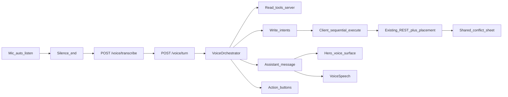

# Specification: Voice Agent (hybrid)

**Status:** shipped (see [roadmap archive](roadmap-archive.md)).  
**Language:** English  
**Last updated:** October 2026  

Voice becomes a **hybrid agent**: multi-turn dialogue, grounded Q&A, and write intents — without a second scheduler. Placement and conflict stay on [spec-conflict-rules.md](spec-conflict-rules.md) and [spec-incremental-placement.md](spec-incremental-placement.md). The shipped one-shot commander contract remains [spec-voice-commander.md](spec-voice-commander.md); this document supersedes it for the **new UI entry path** (`POST /voice/turn`). HTTP details land in [api-reference.md](api-reference.md) when implemented; Groq keys in [integrations.md](integrations.md).

---

## 1. Goals

- Let the user **talk to a smart agent** that reads the calendar/tasks/habits and performs the same mutations the UI can, correctly.
- Keep **one write contract**: orchestrator never mutates the DB; the client executes intents through existing task / habit / placement APIs.
- Support **Q&A**, **multi-turn clarify**, **day-plan propose → confirm → apply**, and a **hero voice UI** (mobile near full-screen, thread, polished audio visuals, silence-based end of speech).
- Stay safe: destructive actions and day-plan apply require confirm; conflict / Problematic stay on existing client paths in v1.

## 2. Non-goals (v1)

- Wake word / always-on microphone.
- Second scheduler brain or inventing free slots outside placement helpers.
- Phases CRUD or Settings changes by voice.
- Piping conflict-sheet or Problematic outcomes back into the agent session (deferred).
- Server-side TTS (keep client `VoiceSpeech` abstraction for a later swap).
- Streaming STT / word-by-word captions.
- Rewriting Whisper / mic capture stack beyond silence detection + UI.
- `undo` action (no product undo API after Generate removal).
- Persisting voice sessions in the database.

---

## 3. Decision log (locked)

| ID | Topic | Decision |
|----|--------|----------|
| L1 / T1 | Client entry | New voice UI **always** calls `POST /voice/turn`. |
| L2 | Clarify budget | Max **2** clarifying questions, then refuse. |
| L3 | Tool surface | Full **read + write-intent** tools mirroring product APIs; limit = product contract, not a short Q&A allowlist. |
| L4 | Write authority | Orchestrator **never** writes DB; client executes intents only. |
| L5 | Confirm | Same as today: always confirm delete / cancel / habit_delete / **day-plan apply**; others follow `confirmVoiceCommands`. |
| L6 | Day-plan / placement | Same requests as normal engine/UI → same Unscheduled / Problematic / conflict rules. Propose without write until Confirm. |
| L7 | “this” / “current” | LLM resolves from context; if unclear → clarify (counts toward budget). |
| L8 | Close widget | **Discard** pending clarify/confirm (no auto-create on close). |
| L9 | After write | Voice surface **stays open** for follow-up. |
| T2 | Intent shapes | Reuse `executeVoiceCommand` + create payloads; extend for day-plan. |
| T3 | Batch | Multiple write intents per turn allowed; client runs **sequentially**; stop on confirm gate / conflict / error. |
| T5 | Failure | One automatic fallback to `parse-task`; then error + Retry. |
| T6 | Conflict feedback | v1: conflict / Problematic **not** fed back into agent session. |
| T7 | Legacy API | Keep public `POST /voice/parse-task` for compatibility, tests, fallback. |
| S1–S2 | Session store | **In-memory** only; **no idle TTL**; clear on widget close (and server restart). |
| S3 | History | Only the **current open-widget chat**. |
| S4 | Tabs | Separate `sessionId` per browser tab. |
| S5 | Open | **Every widget open → new session.** |
| U1 | Chrome | Phone **near full-screen**; desktop large sheet/modal; same component. |
| U2 | Thread | Scrollable user + assistant bubbles. |
| U3a | End of speech | **No Stop button**; silence / VAD ends the utterance; auto-listen when input expected. |
| U3b | Two skips | `skip_speak` = stop TTS only; `cancel` = dismiss pending turn (+ stop speak). |
| U3c | Actions | Agent may return `actions[]`: `confirm` \| `cancel` \| `retry` \| `skip_speak`. |
| U4 | Audio visual | **Replace** current equalizer with a polished listening + speaking visual. |
| U5 | TTS content | Speak clarify, confirm, success/refuse, **and Q&A answers**; not busy/errors. |
| U6 | Day-plan UI | Visual list of proposed slots + short spoken one-liner. |
| U7 | Look | Hero inside **current design system** (ide tokens); not a separate brand theme. |

---

## 4. Architecture

**Rules**

- Reads run **on the server** during the turn (grounded answers).
- Writes are **intents in the response**; client applies them via existing APIs.
- Conflict sheet and Problematic inbox behave as today; agent session does not consume their outcomes in v1.
- `parse-task` remains for fallback / tests; it is not the new UI happy path.

---

## 5. Turn outcomes

| Outcome | Meaning | Typical next UI |
|---------|---------|-----------------|
| `answer` | Grounded Q&A; no write | Speak + thread; auto-listen |
| `clarify` | Ask; wait for next utterance | Speak question; listen (clarify count++) |
| `confirm` | Needs explicit confirm before intents | Show summary / plan list + `confirm`/`cancel` |
| `act` | Client should run `intents[]` | Execute; short result; stay open |
| `refuse` | Cannot proceed safely | Speak/show reason; listen or idle |
| *(conflict)* | Not an orchestrator outcome | Client opens shared conflict sheet during execute |

Clarify count is per open session. After **2** clarifications without resolution → `refuse`.

---

## 6. Logic

### 6.1 Dates and times (LLM-first, split prompts)

Parse is **two LLM steps**: (1) router → `intent` + `language`; (2) one specialist prompt per intent. Each specialist states the JSON the resolver reads, a first-match decision list, and what not to invent. Clarifying questions use the transcript language. Router intent `needs_clarification` returns a question only (`task` and `command` null) and does not create a task.

Create specialist focuses on **kind** (`fixed` / `flexible` / `unscheduled` / `recurring`), **name**, and **when**. Day without clock → flexible with `deadline` (end of day). Recurring with a clear pattern may omit clock. No usable day/clock/window (and no clear recurring pattern) → **Unscheduled** inbox (`complete`), not a day/time clarify loop. Relative speech (“in 3 hours”) resolves from Local calendar anchors. The server does **not** re-parse the transcript for days/clocks beyond contract guards (name required; past slots dropped; no-when → Unscheduled).

### 6.2 Resolve “this” / “current”

The model uses session chat, now-overlapping app task, current habit block, and last mentioned entities. If still ambiguous → `clarify`. No hard-coded task-only rule.

### 6.3 Confirm policy

| Kind | Confirm |
|------|---------|
| delete, cancel, habit_delete | Always |
| day-plan apply | Always |
| Other writes | `confirmVoiceCommands` as today |
| Pure `answer` | No |

Spoken yes/no and action button `confirm` / `cancel` are equivalent.

### 6.4 Day-plan

1. User asks to schedule / arrange tasks for a day (or similar).
2. Server builds a **proposal** from read tools + placement preview helpers (no DB writes).
3. Outcome `confirm` with visual **list of proposed slots** + short spoken one-liner.
4. On `confirm`, response (or follow-up turn) yields **batch** write intents; client applies **one by one** through placement.
5. Stop the batch on conflict sheet, hard error, or user `cancel`. Unscheduled / Problematic follow existing rules; say so in the result line when relevant.

### 6.5 Close / open / stay open

- Open widget → **new** `sessionId`.
- Close → discard server session + pending UI state (no auto-create).
- Successful write → sheet **stays open**; same session continues.

---

## 7. API surface

### 7.1 `POST /voice/turn`

**Request (conceptual)**

- `transcript` (string, required after STT)
- `sessionId` (string, required for an open widget; client generates on open)
- `locale` / timezone: from user settings on server (same as parse-task)
- Optional: client signal for action tap (`actionId`) instead of a new transcript

**Response (conceptual)**

- `sessionId`
- `outcome`: `answer` \| `clarify` \| `confirm` \| `act` \| `refuse`
- `assistantMessage` (string; shown + optionally spoken)
- `intents[]`: zero or more write intents (create / command shapes compatible with today’s client executor), including day-plan apply items
- `actions[]`: subset of `confirm` \| `cancel` \| `retry` \| `skip_speak`
- `proposal` (optional): day-plan visual payload (task id/name, suggested start/end, day)
- `clarifyCount` (optional)

Exact DTO field names are fixed at implementation; behavior above is normative.

### 7.2 Existing endpoints

| Endpoint | Role |
|----------|------|
| `POST /voice/transcribe` | Unchanged STT |
| `POST /voice/parse-task` | Compatibility, tests, **one** orchestrator failure fallback |

### 7.3 Write intent shapes

Reuse today’s resolved command kinds and create task payload consumed by `executeVoiceCommand` / create flow. Add day-plan propose (server-side only / embedded in `proposal`) and apply items that expand to the same create/window/move-style calls the UI would make.

---

## 8. Tool registry (starter + extension)

### 8.1 Starter read tools (server)

- `get_now_next`
- `get_day_agenda` (today or named civil day in settings TZ)
- `list_unscheduled`
- `list_problematic`
- `find_free_gaps`
- `match_task` / `match_habit`
- `get_habit_status` (streak / today check-in)
- `get_task` (by id)

### 8.2 Write intents (client-executed)

All Voice Commander mutations: create/update/delete/complete/skip/cancel/move/window, habit CRUD/check-in/uncheck, plus day-plan apply items. No phases/settings.

### 8.3 Adding a voice tool

When a later product feature needs a new capability:

1. Add a tool id to the registry (read vs write-intent).
2. Define JSON schema + English prompt line.
3. Implement server read **or** client intent executor — never a parallel scheduler.
4. Unit test the tool / intent mapping.
5. Append one short subsection under this heading (and tick roadmap if queued).

Do **not** create a separate Cursor skill for tools; use [new-feature-workflow](../.cursor/skills/new-feature-workflow/SKILL.md) and update this spec in wrap-up.

---

## 9. Session

| Rule | Detail |
|------|--------|
| Store | In-memory on API process |
| Key | `sessionId` (+ user id) |
| Scope | One chat = one open widget instance; per tab |
| History | Current chat turns only (compact server-side copy for the LLM) |
| TTL | None while open; delete on close; gone on process restart |
| Open | Always new `sessionId` |

---

## 10. UI (hero voice surface)

### 10.1 Layout

- **Mobile:** near full-screen dismissible surface.
- **Desktop:** large modal/sheet, same structure.
- **Thread:** scrollable user + assistant messages for the session.
- **Design:** current ide design system; elevated composition (mic, thread, audio visual) — not a new brand theme.

### 10.2 States

| State | UI | Actions |
|-------|-----|---------|
| `listening` | Polished **input** audio visual; mic active | Silence ends utterance; close discards |
| `thinking` | Latest user transcript in thread; working | Close discards |
| `speaking` | Assistant text; polished **speaking** visual; mic gated | `skip_speak` and/or `cancel` as offered |
| `clarify` | Question in thread → return to listening | actions; close discards |
| `confirm` | Summary + optional proposal list | `confirm` / `cancel`; close discards |
| `ready` | Thread; auto-listen when next input expected | close |
| `error` | Error copy | `retry` / close |

Shared **conflict sheet** remains the existing overlay (not redesigned inside voice in v1).

### 10.3 End of speech (no Stop)

- Primary UX: **silence detection** after speech energy (VAD / silence timeout).
- No Stop button as the main control.
- Auto-start listening on open and when the agent expects another user utterance (after speak ends, or immediately if TTS off).

### 10.4 Two skip controls

| Action id | Effect |
|-----------|--------|
| `skip_speak` | Stop TTS + speaking animation only; keep message, proposal, pending confirm, intents |
| `cancel` | Dismiss pending confirm / abandon that assistant act; stop speak if playing |

### 10.5 Action buttons

Orchestrator returns `actions[]` from the fixed vocabulary. Client renders labeled buttons (i18n). Tap equals that choice. Default speaking chrome may always expose `skip_speak`; confirm turns expose `confirm` / `cancel`.

### 10.6 Audio visual (replace current equalizer)

Replace `VoiceMicEqualizer` aesthetics. One visual language, two modes:

- **Listening:** driven by real mic level.
- **Speaking:** motion while TTS plays (pulse/waveform); if `speakVoiceReplies` is off, text remains; speaking motion may be omitted.

Concrete CSS/SVG/canvas (or small dependency) is chosen at implementation; must read as intentional on mobile full-screen.

### 10.7 TTS

- Existing `VoiceSpeech` + `speakVoiceReplies`.
- Speak: clarify, confirm summary, success/refuse, **Q&A answers**.
- Do not speak: busy labels, mic permission errors, raw exceptions.
- Stop speak on `skip_speak`, `cancel`, new listen start, or close.

---

## 11. i18n

- UI chrome + TTS language follow settings `language` (`en` \| `uk`).
- Spoken input stays multilingual via Whisper + prompts (as today).
- New strings: full-screen voice labels, skip speak, dismiss, listening without Stop, day-plan proposal chrome, action labels, session/error copy.

---

## 12. Tests

| Layer | Cover when implementing |
|-------|-------------------------|
| Unit | Orchestrator outcome mapping; clarify budget; tool registry; intent batch ordering; action vocabulary |
| API e2e | `/voice/turn` answer / clarify / confirm / act / refuse; fallback to parse-task once |
| Playwright | Full-screen mobile sheet; thread; silence-end or stubbed end-of-speech; `skip_speak` vs `cancel`; day-plan list + confirm; stay-open after write; close discards |

Extend [e2e-test-coverage.md](e2e-test-coverage.md) with A-VOI / U-VOI rows when each phase ships. Keep existing commander cases green where `parse-task` remains.

---

## 13. Phased delivery

Implement in order (one chat ≈ one phase):

### P1 — Spec in repo + roadmap

- This file + roadmap Now items + docs README link.

### P2 — Orchestrator + session + read tools + `/voice/turn`

- In-memory session; grounded `answer` / `clarify` / `refuse`; client thread + TTS for answers.

### P3 — Write intents + confirm + fallback

- Client executor batch; confirm policy; one `parse-task` fallback; stay open; close discard.

### P4 — Day-plan propose / confirm / apply

- Visual proposal list; sequential placement applies.

### P5 — Hero UX

- Near full-screen mobile; silence end-of-speech; mic gate while speaking; `skip_speak` + `cancel`; polished audio visual; agent `actions[]`.

### P6 — Tests + docs wrap-up

- Unit / API / Playwright; overview + api-reference + e2e coverage; archive roadmap lines when done.

---

## 14. Must not break

- Existing create / complete / skip / reschedule / habit voice flows via fallback and intent parity.
- Shared conflict sheet contract.
- Settings IANA `timeZone` as civil-day source for agenda and placement.
- Incremental placement rules (no invented slots; foreign Google events never moved by the agent).
